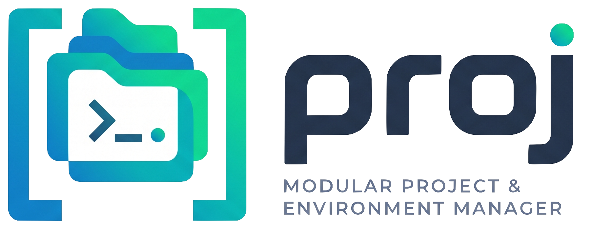
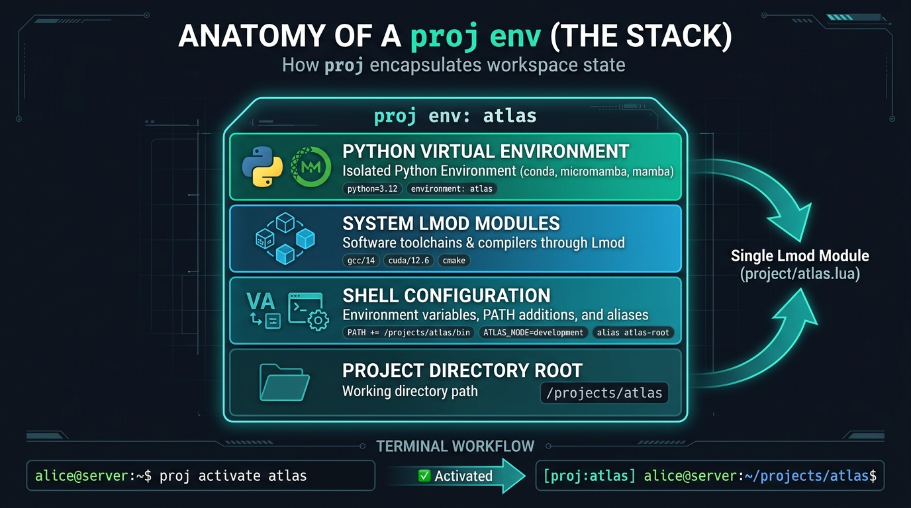
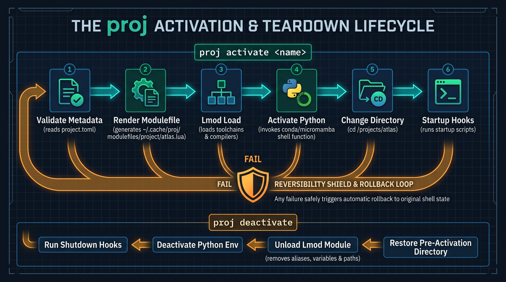
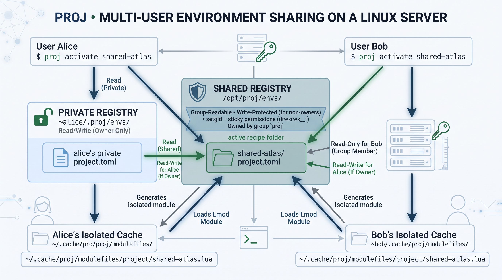
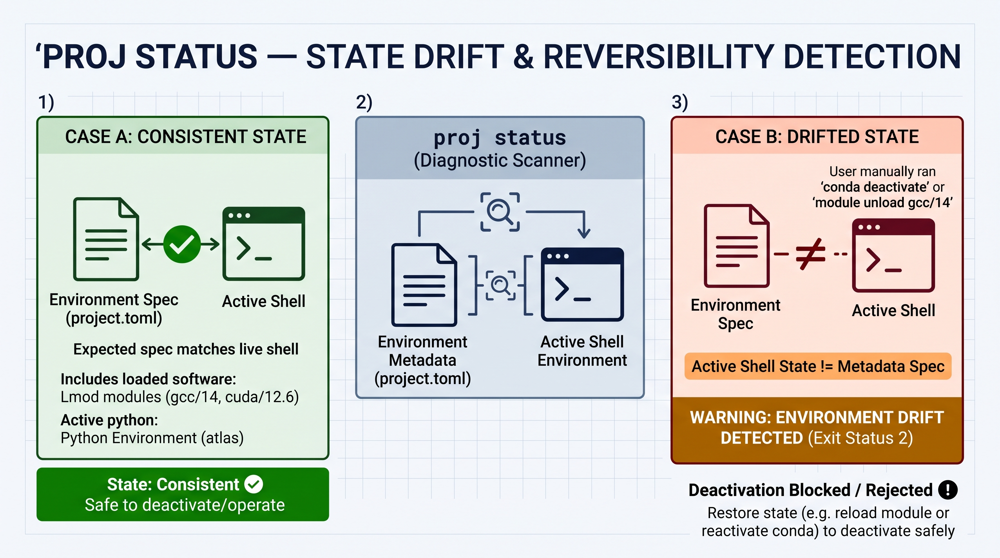

<div align="center">
  

  <p>
    <!-- Replace these with your actual repo badges if you have them -->
    <a href="https://github.com/manuelblancovalentin/proj/actions"></a>
    <a href="https://github.com/manuelblancovalentin/proj/blob/master/LICENSE"></a>
  </p>
</div>

---

# `Proj`: a lightweight modular project & environment Manager

<p>
  <code>proj</code> gives every project a named, reversible shell environment. One command, <code>proj activate &lt;name&gt;</code>, loads the project's toolchains through <a href="https://lmod.readthedocs.io">Lmod</a>, activates its Python environment (micomamba, conda or mamba), sets its variables, paths and alisases, moves you to the project dir, and runs its startup hooks. <code>proj deactivate</code> undoes all of it. Environments can be private or shared with a Unix group, so a whole team on one server activates the same, consistent setup.
</p>

It runs on Linux with Zsh or Bash, needs nothing beyond the system Python
and Lmod, and is installed with a single script, with or without `sudo`.

```console
$ proj activate atlas
 ✅ - Project 'atlas' activated 🚀
$ proj status
Project:      atlas
Root:         /projects/atlas
Metadata:     /home/alice/.proj/envs/atlas/project.toml
Lmod module:  project/atlas
Python env:   atlas (conda)
State:        consistent
$ proj deactivate
 ✅ - Project 'atlas' deactivated ✨
```




## Citation

If you found this work useful, please consider citing it: 
```bibtex
@software{proj2026,
  author = {Blanco Valentin, Manuel},
  title = {proj: Lightweight, Modular Project \& Environment Manager},
  year = {2026},
  publisher = {GitHub},
  url = {https://github.com/manuelblancovalentin/proj}
}
```


## Table of contents

- [Why proj](#why-proj)
- [Concepts: what a proj environment is](#concepts-what-a-proj-environment-is)
- [Installation](#installation)
  - [Requirements](#requirements)
  - [Running the installer](#running-the-installer)
  - [Installer options](#installer-options)
  - [Upgrading and uninstalling](#upgrading-and-uninstalling)
  - [Using a checkout in place](#using-a-checkout-in-place)
- [Quick start](#quick-start)
- [Creating and managing environments](#creating-and-managing-environments)
  - [Create, list, and inspect](#create-list-and-inspect)
  - [Activate and deactivate](#activate-and-deactivate)
  - [Python environments](#python-environments)
  - [Variables, paths, and aliases](#variables-paths-and-aliases)
  - [Hooks](#hooks)
  - [The configuration menu](#the-configuration-menu)
  - [Removing and renaming](#removing-and-renaming)
- [Toolchains and components (Lmod modules)](#toolchains-and-components-lmod-modules)
  - [Adding modules to an environment](#adding-modules-to-an-environment)
  - [Using a module in one word](#using-a-module-in-one-word)
  - [Making software available as a module](#making-software-available-as-a-module)
- [Shared servers](#shared-servers)
  - [Administrator setup](#administrator-setup)
  - [Per-user setup](#per-user-setup)
  - [Creating shared environments](#creating-shared-environments)
  - [Permissions and trust](#permissions-and-trust)
- [Configuration](#configuration)
  - [Configuration files and keys](#configuration-files-and-keys)
  - [Environment variables](#environment-variables)
- [Project metadata reference](#project-metadata-reference)
- [Command reference](#command-reference)
- [Advanced topics](#advanced-topics)
  - [How activation works](#how-activation-works)
  - [State drift and `proj status`](#state-drift-and-proj-status)
  - [Additional metadata roots](#additional-metadata-roots)
  - [Shell integration, completion, and prompts](#shell-integration-completion-and-prompts)
  - [The prompt segment](#the-prompt-segment)
  - [Customizing `proj info` for a site](#customizing-proj-info-for-a-site)
  - [Choosing the Python interpreter that runs proj](#choosing-the-python-interpreter-that-runs-proj)
- [Troubleshooting](#troubleshooting)
- [Development](#development)

## Why proj

Most research and engineering machines end up with the same problem: each
project needs a particular compiler, a particular CUDA or FPGA toolchain, a
particular Python environment, a few variables, and a working directory, and
people rebuild that state by hand in every terminal. Existing tools each cover
part of it:

| Tool | What it does well | What is missing for this job |
|---|---|---|
| Lmod alone (`module load`, collections) | Loads and unloads software cleanly, with dependency and conflict handling | Knows nothing about Python environments, project directories, hooks, or who owns a setup |
| conda / mamba / micromamba alone | Python and binary packages | Does not manage system toolchains, modules, or per-project shell state |
| direnv | Per-directory variables, loaded automatically on `cd` | Implicit activation on directory change, configuration inside the repository, no clean unload of loaded software, no sharing model |
| Spack environments, Nix, devbox | Reproducible builds of whole software stacks | Heavy to adopt on an existing server; they replace how software is installed rather than coordinating what is already there |
| Shell scripts you `source` | Anything you write | Not reversible, not validated, and every project reinvents them |

`proj` is deliberately the thin layer that coordinates those tools instead of
replacing them:

- **Lmod stays authoritative** for software, variables, paths, aliases, and
  dependency reference counts. Every proj environment becomes a generated Lmod
  module, so deactivation is exactly Lmod's unload.
- **Your Python manager stays authoritative** for Python. proj links an
  existing environment; it never creates or modifies one.
- **Activation is explicit.** Opening a shell or changing directory never
  activates anything; only `proj activate` does.
- **Metadata lives outside the repository**, under `~/.proj/envs` or a shared
  registry, so it works for repositories you cannot or do not want to change.
- **Sharing is built in**, with ownership and Unix-group permissions instead
  of a server or database.
- **It is small and dependency-free**: the system Python standard library, a
  POSIX installer, and shell adapters that start no processes at login.

## Concepts: what a proj environment is

A **proj environment** ("env") is a named TOML document,
`<registry>/<name>/project.toml`, that points at a project directory and
describes the shell state the project needs:

- the **project root** to work in;
- **Lmod modules** grouped into four categories: `compiler`, `toolchain`,
  `application`, and `project`;
- an optional **Python environment** and the **manager** that activates it;
- **environment variables**, **PATH additions**, and **aliases**;
- **startup and shutdown hooks** (commands to run on activation and
  deactivation).

An environment contains no software and no copy of your project. It is a
recipe. When you activate it, proj renders it into an Lmod modulefile,
`~/.cache/proj/modulefiles/project/<name>.lua`, and loads that module. The
module declares `family("project")`, so Lmod guarantees that **one proj
environment is active per shell**. Different terminals can have different
environments active at the same time.




Environments live in **registries**:

- the **private registry**, `~/.proj/envs` by default, visible only to you;
- in a shared installation, the **shared registry**, `/opt/proj/envs` by
  default, visible to every member of a Unix group.

## Installation

### Requirements

- Linux, with Zsh 5.9+ or Bash 4.4+ (both can be used on the same machine).
- [Lmod](https://lmod.readthedocs.io), initialized so that `module` is a shell
  function (`type module`). The installer can install it for you.
- Python 3.11+, or Python 3.9+ with `tomli`. proj prefers `/usr/bin/python3`
  so a project's Python can never replace proj's own runtime.
- Optional: micromamba, conda, or mamba, with its shell integration
  initialized, for projects that use a Python environment.
- Optional: network access once, to install the interactive configuration
  menu (Textual, in a private virtual environment; on Debian and Ubuntu this
  needs the `python3-venv` package).

### Running the installer

From GitHub:

```sh
curl -fsSL https://raw.githubusercontent.com/manuelblancovalentin/proj/master/install.sh | sh
```

Or from a checkout:

```sh
git clone https://github.com/manuelblancovalentin/proj.git
sh proj/install.sh
```

Like the conda installer, it asks one question at a time and shows the
default in brackets; press Enter to accept it, or Ctrl+C at any point to
abort (nothing is left behind). It asks for:

1. **Mode**: `private` (just you) or `shared` (members of a Unix group).
2. **Location**: `/opt/proj` by default, or `~/.local/opt/proj` when you
   cannot write to `/opt`. Any directory works; no `sudo` is needed for a
   private install in your home directory.
3. **Registries**: where private environments live (`~/.proj/envs`) and, in
   shared mode, where shared ones live (`PREFIX/envs`).
4. **Python manager**: the default for new environments (`micromamba`,
   `conda`, or `mamba`); the first one found is suggested.
5. **Shells**: for each installed shell, whether to add proj to its startup
   file. Yes is suggested for the shell you are running, your login shell,
   and any shell that already has a startup file.
6. **Configuration menu**: whether to install the optional interactive
   [`proj configmenu`](#the-configuration-menu), which downloads Textual.

It also checks the requirements and offers to install what is missing: Lmod
through your distribution (`apt-get install lmod`, `dnf install Lmod`; this
needs `sudo`) and, if no Python manager exists, micromamba through its
official per-user installer.

Open a new shell afterwards and run:

```sh
proj --version
proj doctor
```

### Installer options

Every question has a flag, and `--yes` accepts all defaults, for unattended
installs:

| Option | Meaning |
|---|---|
| `--prefix DIR` | Installation directory |
| `--mode private\|shared` | Private install, or shared with a group |
| `--group NAME` | Group for shared mode (default `proj`) |
| `--registry DIR` | Private registry (default `~/.proj/envs`; `~` stays per user) |
| `--shared-registry DIR` | Shared registry (default `PREFIX/envs`) |
| `--python-manager NAME` | Default Python manager: `micromamba`, `conda`, or `mamba` |
| `--shell zsh,bash` | Shells to initialize |
| `--init` / `--no-init` | Add or skip the per-user startup-file block |
| `--system-init` / `--no-system-init` | As root, add or skip the block in the system-wide `zshrc`/`bash.bashrc` |
| `--install-deps` / `--no-install-deps` | Install or skip missing Lmod and micromamba |
| `--with-menu` / `--without-menu` | Install or skip the interactive `proj configmenu` (needs network) |
| `--source DIR`, `--ref REF` | Install from a local tree, or download another branch or tag |
| `-y`, `--yes` | Never prompt |

With `curl … | sh`, pass options after `sh -s --`:

```sh
curl -fsSL https://raw.githubusercontent.com/manuelblancovalentin/proj/master/install.sh | sh -s -- --yes --prefix ~/opt/proj
```

### Upgrading and uninstalling

An installed proj upgrades itself:

```sh
proj upgrade                    # check, show what will change, ask, then reinstall
proj upgrade --check            # only report; exits 1 when an update is available
proj upgrade --yes              # no question (required when there is no terminal)
sudo /opt/proj/bin/proj upgrade # when the installation belongs to root (sudo needs the full path)
```

It downloads the archive of the repository and ref this installation recorded
(`PREFIX/etc/source.toml`, written by the installer; `--ref` picks another
branch or tag for one run, and `PROJ_REPO`/`PROJ_REF` override both), compares
versions, and runs that archive's own `install.sh` against the same prefix with
the choices the installation was made with, so a shared install stays shared.
It keeps `PREFIX/etc/config.toml`, never touches shell startup files, installs
no dependencies, and refreshes the configuration menu only if it is already
installed. Nothing happens when the version is already current (`--force`
reinstalls it, or downgrades). The previous version stays in `PREFIX/.previous`;
to roll back, copy its contents over the prefix. Open a new shell afterwards to
load the updated shell integration and completion.

It does not work on a git checkout used in place (use `git pull`), and the
first upgrade to a release that has this command still needs the installer
(`curl … | sh`). Running the installer again with the same prefix does the
same job and remains available; passing `--python-manager` during an
upgrade changes only that setting.

To uninstall, remove the startup-file blocks, then the prefix:

```sh
proj init --shell zsh --reverse
proj init --shell bash --reverse
rm -rf /opt/proj
```

Private environments in `~/.proj/envs` survive both. In a shared install, the
default shared registry `/opt/proj/envs` is inside the prefix, so move it
first if you want to keep the shared environments.

### Using a checkout in place

A git checkout can be used directly instead of an installation. `proj
install` links the command, manual, and TLDR page into the `bin/` and
`share/` directories next to the checkout (for `/tools/proj`, that is
`/tools/bin/proj` and `/tools/share/...`), and refuses to overwrite anything
it did not create. `proj init` then adds the checkout's adapter to your
startup file:

```sh
/tools/proj/bin/proj install
/tools/proj/bin/proj init
```

## Quick start

```sh
cd ~/projects/atlas
proj create atlas                              # register this directory
proj config --env atlas project.description="Atlas simulation"
proj module add compiler gcc/14 --env atlas    # an Lmod module
proj set-python-env --env atlas atlas          # an existing Python environment
proj activate atlas
```

Configure with `--env` before activating, or activate first and configure the
active environment. Changes to an active environment take effect after
`proj deactivate && proj activate atlas`.

## Creating and managing environments

### Create, list, and inspect

```sh
proj create <name>                 # register the current directory
proj create <name> --root DIR      # register another directory
proj list                          # NAME, SCOPE, OWNER, DESCRIPTION, ROOT
proj avail [category|name]         # modules Lmod can load, grouped by category
proj info                          # overview: environments and available modules
proj info --env <name>             # every effective setting of one environment
proj env show <name>               # settings plus the generated module path
proj env list                      # generated modules and whether they are current
```

Names may contain letters, digits, dots, underscores, and dashes, and must
not already be in use. `proj create` writes a valid starter document and
prints its path: only the name, root, and Python manager are active, and every
optional field is present as a commented-out example. Edit it with `proj
config` (validated and atomic) or by hand.

`proj config` reads or writes one key at a time, for the active environment
unless `--env` is given:

```sh
proj config project.description="Atlas simulation"   # write
proj config project.description                      # read
proj config --env atlas python.environment            # another environment
```

Values use TOML syntax when needed (arrays, quoted strings); plain text is a
string. Unknown keys are rejected, and a change that would make the document
invalid is rolled back. See the
[metadata reference](#project-metadata-reference) for every key.

### Activate and deactivate

```sh
proj activate atlas
proj current            # prints the active name; exits 1 when none is active
proj status             # active environment and whether its state drifted
proj deactivate
```

Activation, in order: validate the metadata, generate or reuse the modulefile,
load it with Lmod (which loads every module dependency), activate the Python
environment, change to the project root, and run startup hooks. If any step
fails, everything already done is undone. Deactivation runs shutdown hooks,
deactivates exactly the Python environment level proj created, unloads the
module, and returns you to the previous directory.

Only one environment is active per shell; deactivate before activating
another. If your login already loaded modules the environment replaces (another
version of the same tool, say), the environment's choice wins while it is
active, and deactivating puts your own modules back (`restore_login_modules = false`
in the `[behavior]` table of the configuration turns this off).

Other programs can read environments and the module catalogue as JSON; see
[machine-readable output](docs/machine-readable.md).

A coding agent working in a project can read
[how proj declares and enters a Python environment](docs/for-project-agents.md)
(conda-family environments and a `venv` inside the project folder).

### Python environments

proj links an **existing** environment; create it with your manager first:

```sh
conda create -n atlas python=3.12          # or micromamba / mamba create
proj python-env list                       # environments of the default manager
proj set-python-env --env atlas atlas
proj set-python-env --env atlas atlas --manager mamba
proj set-python-env --env atlas /path/to/prefix   # by absolute prefix
```

Each environment records its manager in `python.manager`: `micromamba`,
`conda`, or `mamba`. New environments use the configured default
(`python_manager`, set by the installer). Activation calls that manager's shell
function, so its shell integration must be initialized (`micromamba shell
init`, `conda init zsh`, `mamba shell init`). A `mamba` that was never
initialized falls back to `conda`, which manages the same environments. The
manager's root environment appears as `base`.

### Variables, paths, and aliases

```sh
proj config environment.ATLAS_MODE=development
proj config environment.ATLAS_DATA='${project.root}/data'
proj config paths.prepend='["${project.root}/bin", "${project.root}/scripts"]'
proj config aliases.atlas-root='cd ${project.root}'
```

Values may use four placeholders and nothing else: `${project.name}`,
`${project.root}`, `${project.metadata}`, and `${user.home}`. Shell syntax,
command substitution, and other variables are rejected. PATH additions must
be absolute and stay inside the project root. Lmod applies and reverses all of
these.

### Hooks

Hooks are commands run on activation (`startup`) and deactivation
(`shutdown`), in the project root, without a shell. Each hook is an argument
array:

```sh
proj config hooks.startup='[["./scripts/check-licenses"], ["make", "-s", "env-check"]]'
proj config hooks.shutdown='[["./scripts/stop-services"]]'
```

A failing startup hook aborts activation and rolls it back. Hooks run as
child processes, so they cannot change your shell; anything they start
outside the shell (servers, mounts) needs a matching shutdown hook.

### The configuration menu

`proj configmenu` edits an environment in a full-screen menu instead of one
`proj config` command at a time. Run it inside an active environment, or pass
`--env <name>`:

```text
┌ Configure ─────────────────────────────┐┌ project.toml • unsaved changes ──┐
│ Name         atlas                     ││  4 [project]                     │
│ Scope        private                   ││  5 name = "atlas"                │
│ Owner        alice                     ││  6 root = "/projects/atlas"      │
│ Metadata     ~/.proj/envs/atlas/…      ││❯ 7 description = "Atlas sim"     │
│ ────────────────────────────────────── ││  …                               │
│ Description          Atlas sim         ││❯18 toolchain = ["cmake/3.30"]    │
│ Python environment   not set (recom…)  ││                                  │
│ Toolchain modules    cmake/3.30        ││                                  │
│ …                                      ││                          ✔ valid │
└────────────────────────────────────────┘└──────────────────────────────────┘
```

- **Left panel**: the fixed facts about the environment (name, scope, owner,
  metadata file), then everything you can set: description, project root,
  Python manager, Python environment, startup and shutdown hooks, and modules
  for each category. Unset settings worth filling in are marked
  *recommended*. Click an entry or press Enter to open its dialog.
- **Right panel**: `project.toml` exactly as it will be saved, with changed
  lines marked `❯` and a live validity check.
- **Dialogs** show live choices: Python managers found on `PATH`, the
  manager's environments, and the modules Lmod can load. These lists are
  scanned when a dialog first opens and cached; **Rescan** refreshes them. The
  module dialog lists the modules tagged with that category (see
  [Adding modules](#adding-modules-to-an-environment)) plus untagged ones,
  which are flagged; *Show all categories* reveals the rest, and modules you
  already chose stay visible. It filters as you type; Enter selects the only
  match, or adds a module Lmod does not list, and Space toggles entries.
  proj's own generated `project/<name>` modules are never offered.
- **Saving**: `Ctrl+S` or the *Save changes* entry, through the same
  validated, atomic write as `proj config`. Changes to an active environment
  apply after reactivation.
- **Escape** always closes a dialog without changing anything. On the main
  screen it quits, but with unsaved changes it asks first, and both Escape
  and Enter in that question mean *no, stay*.

The menu is built with [Textual](https://textual.textualize.io) and is the
only part of proj with a third-party dependency. It runs from a private
virtual environment inside the installation, `PREFIX/libexec/menu`, so no
project environment can affect it and the rest of proj never loads it. The
installer offers to set it up (it needs network access); otherwise:

```sh
proj configmenu --setup              # or: sudo /opt/proj/bin/proj configmenu --setup
```

### Removing and renaming

```sh
proj remove atlas                   # asks before removing anything
proj remove atlas --yes             # no questions; keeps other files
proj remove atlas --yes --delete-files
```

`proj remove` shows what it will do and asks `Remove environment 'atlas'?`
(default no). Removing an environment deletes its `project.toml`, which is
what registers it. If anything else exists for it, other files you added to
its directory (`~/.proj/envs/atlas/`, or its folder in the shared registry)
and the modulefile proj generated in `~/.cache/proj`, it lists them and asks
whether to delete those too. `--delete-files` and `--keep-files` answer that
question in advance; with `--yes` alone, they are kept.

It never touches the project directory or the Python environment, which proj
did not create. It refuses to remove the environment active in your shell
(deactivate first), and only the owner can remove a shared environment. If
someone else has the environment active when it is removed, their
`proj deactivate` still works. Without a terminal, `proj remove` requires
`--yes`.

A name cannot be changed after creation: create a new environment with the
same settings and remove the old one.

## Toolchains and components (Lmod modules)

### Adding modules to an environment

Toolchains, compilers, and applications reach an environment as Lmod modules.
Each module goes into one of four categories, which only organize the
metadata; they are not an Lmod concept:

| Category | Typical contents |
|---|---|
| `compiler` | `gcc/14`, `llvm/18`, `nvhpc/24.5` |
| `toolchain` | `cmake/3.30`, `ninja/1.12`, `node/24.18.1`, `cuda/12.6` |
| `application` | `vivado/2024.2`, `matlab/R2024b` |
| `project` | modules shared by a group of related projects |

`proj avail` shows what Lmod can load right now, grouped by these categories,
with each module's versions (`*` marks the default) and the environments that
already use it. `proj avail compiler` or `proj avail gcc` filters the list, and
`proj avail --json` is meant for scripts. `proj info` with no environment
selected shows the same catalog beneath your list of environments, which is
the quickest way to see what to pick when creating a new one.

A modulefile places itself in a category with a tag; modules without one are
listed as *Uncategorized*:

```lua
whatis("Category: toolchain")   -- compiler, toolchain, application, or project
```

```sh
proj avail                                     # what Lmod can load, by category
proj module add toolchain cmake/3.30           # active environment
proj module add compiler gcc/14 --env atlas
proj module list toolchain
proj module remove toolchain cmake/3.30
```

Completion helps: `proj module add toolchain <Tab>` lists the modules Lmod
can load right now, and `proj module remove toolchain <Tab>` lists those the
environment uses. Names in the `project/` namespace are reserved for the
modules proj generates from environments, so an environment cannot depend on
itself or on another environment. proj does not check that a module exists when you add it;
a missing module makes `proj activate` fail and roll back.

### Using a module in one word

`proj use` is the short form of `proj module add`: name the library, suite, or
tool, and proj finds the module, reads its category and who may use it from the
module itself, and records it in the environment.

```sh
proj create atlas --use alpha --use flowkit    # at creation
proj use alpha                                 # in the active environment
proj use beta/1.1 --env atlas          # a pinned version, another environment
proj use                                      # what this environment uses now
proj use --list                               # what you could use, by category
proj unuse alpha
```

- **Names.** `alpha` finds the module `pdk-alpha`, `flowkit` finds
  `suite-flowkit`, and an exact module name (`simtool`, `simtool/20.1`) works too.
  If more than one of those exists, or none does, proj prints the candidates
  and stops; it never guesses. Type the full module name to choose one.
- **Category.** It comes from the module's `whatis("Category: ...")` tag, so you
  never name it. A module without a valid tag is refused with the fix.
- **Versions.** `name/version` pins that version. A bare name stores the bare
  module name, so the module's own default decides (for example a `default`
  symlink to the current release).
- **Effect.** In the active environment the change is applied to your shell as
  well as saved, the way activation would have, and remembered for next time;
  `unuse` unloads it and forgets it. In another environment (`--env`) it takes
  effect at the next activation. A module that cannot coexist with one the
  environment already uses (another version of it, or another member of the
  same Lmod family, such as one `pdk-*` library for another) replaces it, and
  proj says so.
- **Access.** A module may carry `whatis("Group: <unix group>")` (several groups
  separated by commas or spaces, or `any`; no tag means everyone). If you are
  not in one of them, `proj use alpha` stops with *alpha needs the Unix group
  alpha (you are not in it). Ask an administrator.* and `proj use --list` shows
  only what you can use, plus a short section of modules that exist but need a
  group you lack.
- **Completion.** `proj use <Tab>` offers the short names you can use,
  and `proj unuse <Tab>` those the environment uses.

Modules meant for this should be named `pdk-<name>` (libraries) or
`suite-<name>` (tool suites), and carry the tags:

```lua
whatis("Category: project")    -- compiler, toolchain, application, or project
whatis("Group: alpha")          -- who may use it; "any", or omit, for everyone
family("pdk")                  -- libraries of one family replace each other
```

`proj module add/remove` still works unchanged, with an explicit category.

### Making software available as a module

If a tool is not in `module avail`, install it anywhere and describe it with a
small Lua modulefile. A common layout keeps software and modulefiles apart:

```text
/opt/software/node/24.18.1/        the installed software
/opt/modulefiles/node/24.18.1.lua  its modulefile
```

```lua
-- /opt/modulefiles/node/24.18.1.lua
help("Node.js 24.18.1")
whatis("Name: Node.js")
whatis("Version: 24.18.1")
family("node")                       -- at most one node version at a time
whatis("Category: toolchain")        -- where `proj avail` lists it

local root = "/opt/software/node/24.18.1"
prepend_path("PATH", pathJoin(root, "bin"))
setenv("NODE_HOME", root)
```

Then add the directory to Lmod's search path. `module use` affects only the
shell it runs in, so for everyone it belongs in your distribution's Lmod
configuration or the site shell init, and for yourself in your startup file
before the proj block:

```sh
module use /opt/modulefiles             # shared modules
module use ~/modulefiles                # personal modules
```

Check it with `proj avail node`, then run `proj module add toolchain
node/24.18.1`. Lmod's documentation covers modulefiles in depth, including
`depends_on`, `prereq`, and hierarchical module trees.

## Shared servers

A shared installation lets a group of people on one machine use the same
environments: an administrator installs proj once, every group member can
activate every shared environment, and each environment can be changed only
by its creator unless it is made group-writable.



### Administrator setup

1. Create the group and add its members (members must log in again for the
   membership to apply):

   ```sh
   sudo groupadd proj
   sudo usermod -aG proj alice
   ```

   Reusing an existing group, such as the one that already shares a conda
   installation, works too: pass `--group <name>`.

2. Install as root in shared mode:

   ```sh
   curl -fsSL https://raw.githubusercontent.com/manuelblancovalentin/proj/master/install.sh \
     | sudo sh -s -- --mode shared --group proj --python-manager conda
   ```

   `sudo` hides your `PATH`, so name an existing conda or mamba with
   `--python-manager`. The installer offers to create a missing group.

3. Decide how shells load proj:
   - **System-wide**: accept the installer's offer (or pass `--system-init`)
     to add proj to `/etc/zsh/zshrc` (or `/etc/zshrc`) and `/etc/bash.bashrc`
     (or `/etc/bashrc`) for every user.
   - **Site profile**: pass `--no-system-init` and source
     `/opt/proj/shell/init.bash` or `init.zsh` from your own site profile
     scripts (see [Customizing `proj info` for a site](#customizing-proj-info-for-a-site)).
   - **Per user**: pass `--no-system-init` and let each user run `proj init`.

4. Put your module directories on every user's `MODULEPATH`. `module use <dir>`
   changes only the shell it runs in (Lmod does not remember it), so a
   directory such as `/opt/modulefiles` has to be added by the site init that
   already initializes Lmod, for every shell:

   ```sh
   module use /opt/modulefiles      # guarded and idempotent in your site profile
   ```

   An environment's modules can only load if the shell can already see them;
   proj adds nothing but its own generated modules. `proj doctor` reports
   *module path* when `MODULEPATH` has no module directories, and `proj avail`
   and the configuration menu explain the same thing when they find none.

The result:

| Path | Owner and mode | Meaning |
|---|---|---|
| `/opt/proj` | root, readable by all | The code; upgrades need `sudo` |
| `/opt/proj/etc/config.toml` | root, `644` | Site configuration |
| `/opt/proj/envs` | root:`proj`, `3770` | Shared registry: members create entries and nobody else can look inside; setgid keeps the group, sticky stops members from removing each other's environments |

To make proj itself usable only by the group, also run
`sudo chgrp proj /opt/proj && sudo chmod 750 /opt/proj`.

### Per-user setup

Each member, once:

```sh
/opt/proj/bin/proj init --shell zsh      # and/or --shell bash; skip if loaded system-wide
proj doctor                              # expect "shared registry ... ok"
```

`proj doctor` reports a missing group membership and explains how to fix it.
Each user keeps a private registry too; a private environment with the same
name as a shared one takes precedence for that user.

### Creating shared environments

```sh
cd /data/projects/atlas
proj create atlas --shared                     # only you can change it
proj create atlas --shared --group-writable    # any member can change it
proj create atlas --shared --group lab         # the environment belongs to group lab
proj create atlas --shared --group lab --private   # and only lab can see or change it
proj set-python-env --env atlas atlas          # recorded by prefix path
proj module add toolchain cuda/12.6 --env atlas
proj list                                      # SCOPE "shared", OWNER you
```

### Sharing an environment you already have

```sh
proj share atlas                     # move your private atlas to the shared registry
proj share atlas --group-writable    # ... and let any member change it
proj share atlas --group lab         # ... giving it to the group "lab"
proj share atlas --group lab --private   # ... and only lab can see it
proj unshare atlas                   # back to private (only its creator)
```

The environment keeps its name, its metadata and its other files; it is copied
into place and the old copy is removed last, so a failure leaves it where it
was. `proj share` refuses a name the shared registry already has, and neither
command moves the environment active in the current shell. `proj unshare` also
refuses while a program you can see (started from a shell that had activated
it) still has it active; `--force` skips that check. Other people's shells are
invisible to it unless you are root, so tell the group first.

Everyone in the group can now run `proj activate atlas`. For that to work for
them, the project root and the Python environment must be readable by the
group. In a shared environment, `set-python-env` records the environment's
full prefix (for example `/opt/miniforge3/envs/atlas`), so every member
activates the same one regardless of their own conda settings.

### Permissions and trust

- Owner-only environments are created `2755` with a `644` document;
  `--group-writable` ones `2775` and `664`; `--private` ones `2770` and `660`,
  which only their group can see (and change). Edits keep those permissions.
  `proj access <name>` shows the level and `--owner-only`, `--group-writable` or
  `--private` changes it later (only its creator can; the group stays).
- An environment belongs to the registry's group unless created or shared with
  `--group GROUP`, a group you are in. Its members also need access to the
  registry itself, which is the registry's group: the registry is the outer
  gate, the environment's group the inner one.
- `proj list` leaves out shared environments you have no permission to read
  and says how many in one line; `proj list --json` counts them in
  `unreadable` and prints nothing about them.
- `proj config` on an environment you cannot change fails with
  `environment 'atlas' belongs to alice`.
- **Activation is a trust boundary.** Hooks and aliases from someone else's
  environment run as you. proj prints a notice when you activate an
  environment you do not own, and a group-writable environment lets every
  member change those hooks. World-writable metadata is always refused.
- One broken document in the shared registry is reported by `proj list` and
  `proj doctor` and skipped; it does not break proj for anyone else.
- Generated modulefiles are cached per user, so activation only needs read
  access to the shared metadata.

## Configuration

### Configuration files and keys

Two files accept the same keys; the user file overrides the site file key by
key:

1. `PREFIX/etc/config.toml`: site configuration written by the installer.
2. `~/.config/proj/config.toml`: optional per-user configuration.

```toml
schema = 1
registry = "~/.proj/envs"            # private registry; ~ expands per user
shared_registry = "/opt/proj/envs"   # shared registry (shared installs)
group = "proj"                       # required with shared_registry
python_manager = "conda"             # default manager: micromamba, conda, mamba
library_prefixes = ["pdk-"]          # module-name prefixes of protected libraries
library_names = ["iplibs"]           # protected libraries that do not use a prefix
project_roots = ["/srv/team-envs"]   # extra metadata roots
module_cache = "~/.cache/proj/modulefiles"

[behavior]
change_directory = true              # cd to the project root on activation
run_startup_hooks = true             # run startup hooks on activation
restore_login_modules = true         # deactivate loads back login modules the environment displaced
```

Unknown keys are rejected, so typos fail loudly. `proj doctor` shows the
effective site configuration, registries, and Python manager.

### Environment variables

| Variable | Overrides |
|---|---|
| `PROJ_HOME` | Private registry home (`$PROJ_HOME/envs`) |
| `PROJ_CONFIG`, `PROJ_SITE_CONFIG` | User and site configuration files |
| `PROJ_SHARED_REGISTRY`, `PROJ_GROUP` | Shared registry and its group |
| `PROJ_PYTHON_MANAGER` | Default Python manager |
| `PROJ_PROJECT_ROOTS` | Extra metadata roots (colon-separated) |
| `PROJ_CACHE_HOME` | Cache directory (`~/.cache/proj`) |
| `PROJ_PYTHON` | Interpreter that runs proj |
| `PROJ_PROMPT` | `off` stops the adapters from adding the prompt segment |
| `PROJ_GLOBAL_BIN`, `PROJ_GLOBAL_MAN`, `PROJ_GLOBAL_TLDR` | Link targets of `proj install` |

While an environment is active, proj sets `PROJ_ACTIVE`, `PROJ_ROOT`,
`PROJ_METADATA`, `PROJ_MODULE`, and `PROJ_MAMBA_ENV` (the Python
environment).

## Project metadata reference

```toml
schema = 1

[project]
name = "atlas"                         # required; fixed after creation
root = "/projects/atlas"               # required
description = "Atlas simulation"       # defaults to the name
shell = "zsh"                          # zsh or bash; informational

[python]
manager = "conda"                      # micromamba, conda, or mamba
environment = "atlas"                  # name, or absolute prefix path

[modules]
compiler = ["gcc/14"]
toolchain = ["cmake/3.30", "ninja/1.12"]
application = []
project = []

[environment]
ATLAS_MODE = "development"
ATLAS_DATA = "${project.root}/data"

[paths]
prepend = ["${project.root}/bin"]      # must stay inside the root

[aliases]
atlas-root = "cd ${project.root}"

[hooks]
startup = [["./scripts/check-licenses"]]
shutdown = [["./scripts/stop-services"]]

[commands.build]                       # validated; execution reserved
description = "Build the project"
command = ["./scripts/build"]
```

Keys accepted by `proj config`: `project.description`, `project.root`,
`project.shell`, `python.manager`, `python.environment`, `paths.prepend`,
`hooks.startup`, `hooks.shutdown`, `modules.<category>`,
`environment.<VARIABLE>`, and `aliases.<name>`. Details:
[docs/metadata.md](docs/metadata.md).

## Command reference

| Command | Purpose |
|---|---|
| `proj create <name> [--root DIR] [--shared [--group GROUP] [--group-writable\|--private]] [--use NAME]...` | Register a project |
| `proj share <name> [--group GROUP] [--group-writable\|--private]` / `proj unshare <name> [--force]` | Move a private environment to the shared registry, or back |
| `proj access <name> [--owner-only\|--group-writable\|--private]` | Show or change who can see and change a shared environment |
| `proj use [name[/version]]... [--env NAME] [--list]` | Use a library, suite, or tool; with no name, show what is used |
| `proj unuse <name>... [--env NAME]` | Stop using a module |
| `proj list [--json] [--scope all\|shared\|private] [--under DIR]...` | List environments with scope and owner; `--json` prints a snapshot for other programs |
| `proj catalog` | Print, as JSON, the modules, suites and bundles a person may add to a login |
| `proj avail [category\|name] [--json]` | List the modules Lmod can load, by category |
| `proj activate <name>` / `proj deactivate` | Enter or leave an environment |
| `proj remove <name> [--yes] [--delete-files\|--keep-files]` | Delete an environment, asking first |
| `proj current` | Print the active environment |
| `proj status` | Show the active environment and any drift |
| `proj info [--env NAME]` | Show one environment's settings; with none selected, an overview of environments and available modules |
| `proj config [--env NAME] <key>[=<value>]` | Read or write metadata |
| `proj configmenu [--env NAME] [--setup]` | Edit an environment in an interactive menu |
| `proj set-python-env [--env NAME] [--manager M] <environment>` | Link a Python environment |
| `proj python-env list [--manager M]` | List Python environments |
| `proj module {list\|add\|remove} <category> [module] [--env NAME]` | Manage Lmod modules |
| `proj env list` / `proj env show <name>` | Inspect generated modules |
| `proj doctor` | Check the installation and this shell |
| `proj init [--shell zsh\|bash] [--rc FILE] [--reverse]` | Add or remove the startup-file block |
| `proj upgrade [--check] [--yes] [--force] [--ref REF]` | Reinstall proj from its source repository |
| `proj install` | Link a checkout into the neighbouring `bin/` and `share/` |
| `proj --version` | Print the version |

`--project` is accepted as an older spelling of `--env`. The complete
reference is `man proj`; `tldr proj` has short examples.

## Advanced topics

### How activation works

`proj` has two parts. The command, `bin/proj`, is a Python program that
validates metadata, renders modulefiles, and prints shell code. The shell
adapter (`shell/init.zsh` or `shell/init.bash`, sharing `shell/core.sh`)
defines a `proj` shell function, because only a function can change the shell
you are typing in. For `activate`, the function asks the command for a line
such as `_proj_activate atlas /projects/atlas project/atlas …` and evaluates
it.

The generated module for the metadata example above contains, in part:

```lua
family("project")
depends_on("cmake/3.30")
depends_on("ninja/1.12")
depends_on("gcc/14")
setenv("PROJ_ACTIVE", "atlas")
setenv("ATLAS_MODE", "development")
prepend_path("PATH", "/projects/atlas/bin")
set_alias("atlas-root", "cd /projects/atlas")
```

A content digest avoids rewriting it when nothing changed. Nothing about
activation is stored outside the shell itself. See
[docs/architecture.md](docs/architecture.md) and
[docs/lifecycle.md](docs/lifecycle.md).

### State drift and `proj status`

If you unload one of the environment's modules or switch Python environments
by hand, `proj status` reports the drift and exits with status 2, and `proj
deactivate` refuses to guess how to undo it. Restore the expected state (for
example `conda activate atlas`) and deactivate again.



### Additional metadata roots

`project_roots` (or `PROJ_PROJECT_ROOTS`) adds directories that are searched
one level deep for `*/project.toml`, for example environments kept in a
repository of team configuration. Search order is also precedence: private
registry, shared registry, then extra roots.

### Shell integration, completion, and prompts

The startup-file block that `proj init` writes only sources the adapter.
Sourcing it never activates an environment, scans for projects, or starts a
process, so it adds a couple of milliseconds to shell startup. The adapter:

- puts proj's `bin/`, manual, and TLDR directories on `PATH`, `MANPATH`, and
  `XDG_DATA_DIRS`, once;
- shows `[proj:<name>]` in the prompt while an environment is active (see
  [The prompt segment](#the-prompt-segment));
- registers completion for commands, options, environment names, Python
  environments, and Lmod modules, computed only when you press Tab;
- adds a `mamba` alias for `micromamba` at the first prompt, unless a real
  `mamba` exists;
- uses the dots shell framework's `ok`/`info`/`error` helpers and panel for
  `proj info` when dots is loaded, with a plain fallback otherwise.

### The prompt segment

While an environment is active, the adapters show `[proj:<name>]` in front of
your prompt, and nothing once it is deactivated:

```text
user@host:~$ proj activate maple
[proj:maple] user@host:maple$
```

Whoever owns the prompt should draw it, so this is a default, not a takeover:

- The adapter maintains `PROJ_PROMPT_SEGMENT` (empty when nothing is active)
  in the shell's own format, with no subprocess per prompt.
- If the prompt does not mention that variable, the hook puts the segment in
  front of `PS1` (Bash) or `PROMPT` (Zsh), and again if a theme rebuilds the
  prompt. A prompt that wants it elsewhere includes it itself, for example
  `PS1='\u@\h \w ${PROJ_PROMPT_SEGMENT}\$ '`; the hook then leaves `PS1`
  alone. In Zsh the value uses prompt escapes, so place it with `prompt_subst`.
- A framework that already draws the badge from `$PROJ_ACTIVE` takes
  precedence: with dots loaded, proj adds nothing (unless `DOTS_PROMPT=never`),
  so the badge never appears twice.
- `PROJ_PROMPT=off` disables the automatic insertion (the variable is still
  maintained), and `NO_COLOR` makes the segment plain text.

Any other prompt can read `$PROJ_ACTIVE` directly.

### Customizing `proj info` for a site

A site profile sourced after the adapter can draw `proj info` its own way by
defining `_proj_render_info`, which receives the environment name followed by
label/value pairs:

```bash
. /opt/proj/shell/init.bash

_proj_render_info() {
  local name=$1
  shift
  printf '== %s ==\n' "$name"
  while (( $# >= 2 )); do printf '  %s: %s\n' "$1" "$2"; shift 2; done
}
```

The same profile is the place for site-specific banners or links; keep them
there rather than in proj.

### Choosing the Python interpreter that runs proj

proj runs with `/usr/bin/python3` so that an active environment's Python can
never replace it. If the system Python cannot read TOML (before 3.11, without
`tomli`), the installer records a suitable `python3` in `PREFIX/etc/python`.
`PROJ_PYTHON` overrides both.

## Troubleshooting

Start with `proj doctor`; every failing check names the fix. Common cases:

- **`activate must run through the shell integration`**: run `proj init` and
  open a new shell.
- **`module function: not initialized in this shell`**: Lmod's shell function
  is missing, often after starting Zsh from a Bash login. Add the `source
  …/lmod/init/zsh` line that doctor prints to your startup file.
- **`<manager> shell integration is unavailable`**: initialize the Python
  manager's shell hook (`conda init zsh`, `micromamba shell init`).
- **`not a member of group 'proj'`**: ask for `usermod -aG proj <user>`, then
  log in again.
- **`proj avail` or the configuration menu lists no modules** (or only
  `project/<name>`): `MODULEPATH` has no module directories in this shell.
  `module use /opt/modulefiles` fixes the current shell only; add it to the
  site init so every shell has it (`proj doctor` shows the *module path*
  check).
- **`proj` runs a different program**: some systems ship an unrelated
  `/usr/bin/proj` (the PROJ cartography tool); initialize the shell so proj's
  `bin/` comes first.

More in [docs/troubleshooting.md](docs/troubleshooting.md).

## Development

```sh
./tests/run          # unit tests plus Zsh, Bash, installer, and sharing checks
./tests/benchmark    # shell initialization time
```

The tests use fake `module` and Python-manager functions, so they run on
machines without Lmod or conda; `proj doctor` always reports the real host.
Task definitions (`[commands.*]`) are validated and displayed, but `proj run`
is not implemented yet. Contributor notes and invariants are in
[AGENTS.md](AGENTS.md).
